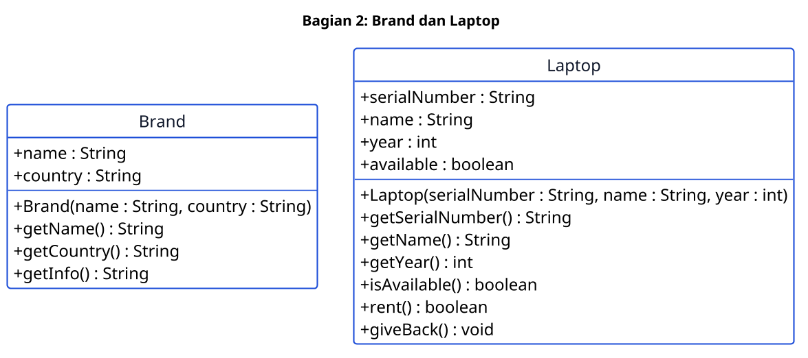
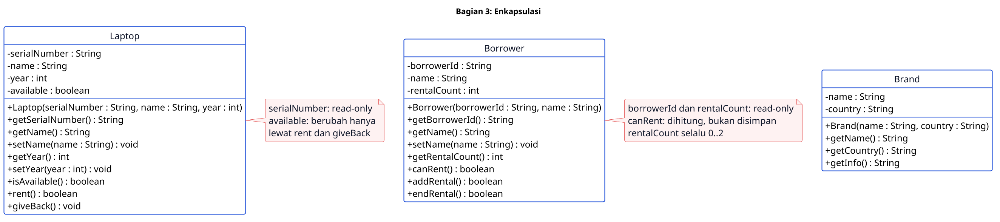
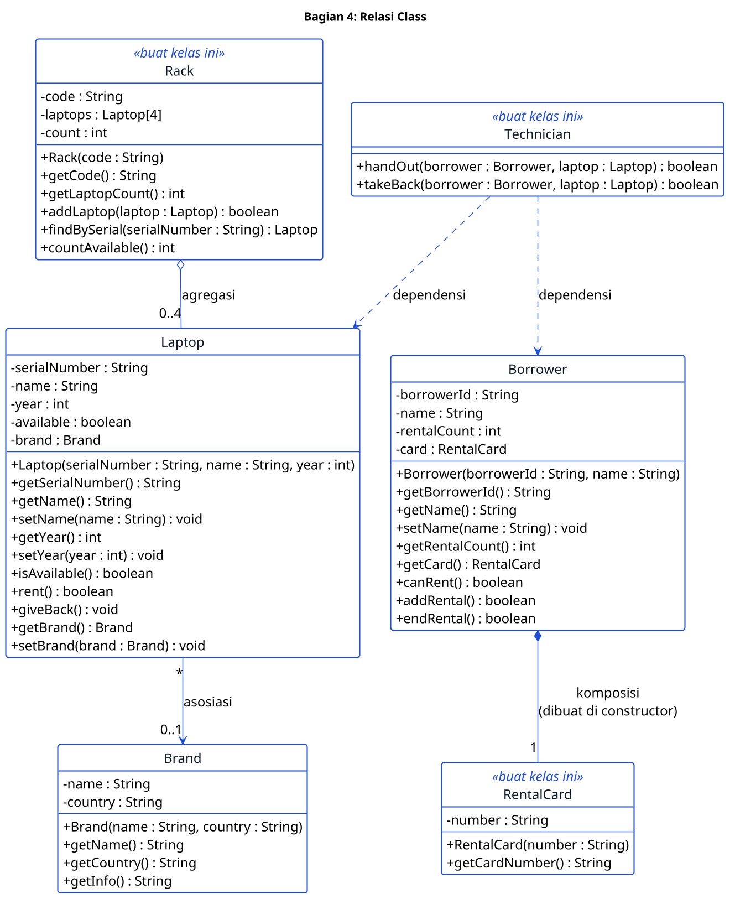
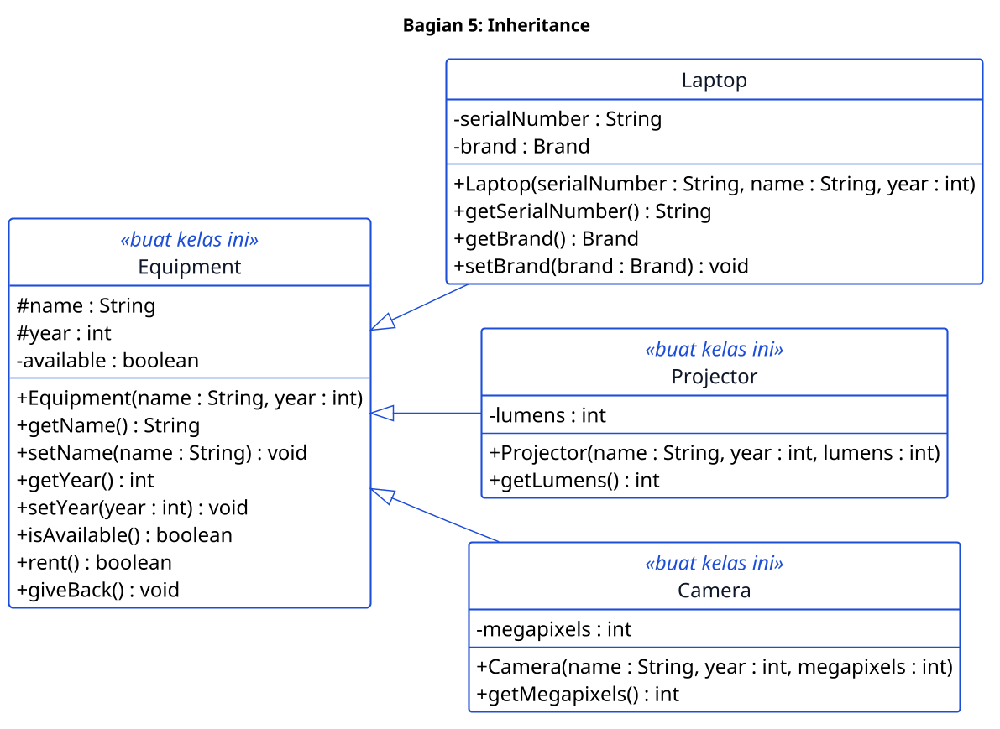
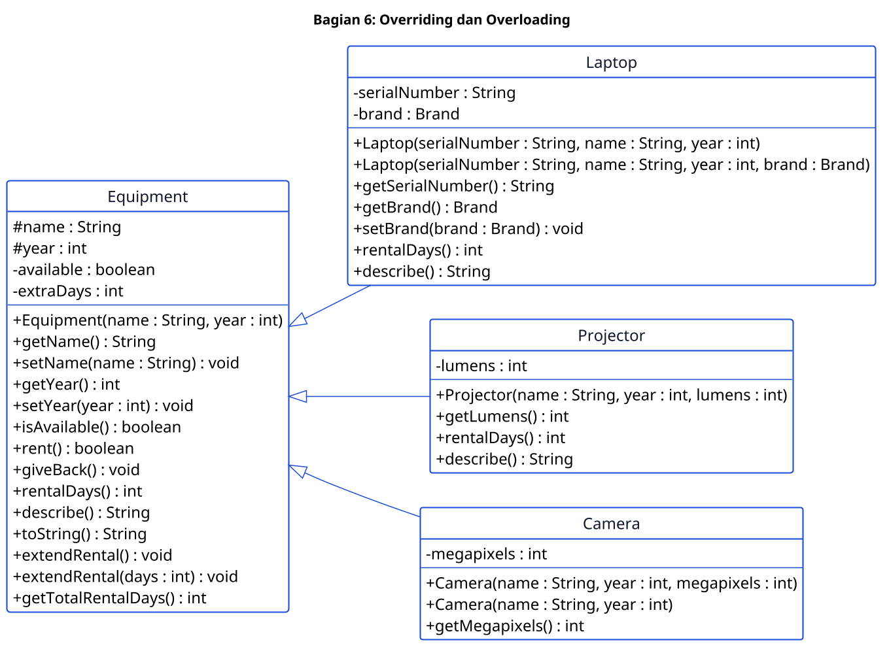
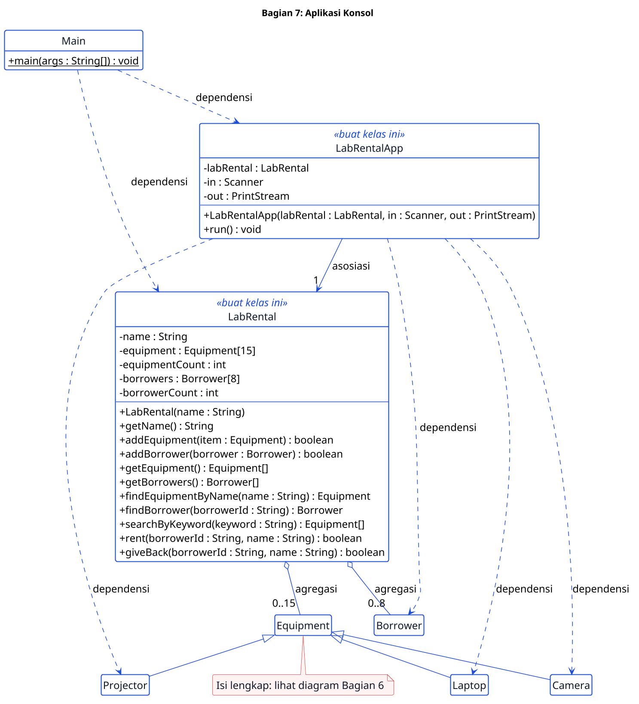

# Latihan OOP Susulan: Aplikasi Konsol Penyewaan Alat Laboratorium (Pertemuan 1 sampai 7)

> **Kuis Susulan.** Soal ini untuk mahasiswa yang tidak mengikuti kuis utama (`oop-library`). Materi, struktur, tingkat kesulitan, jumlah tes, dan bobot nilainya sama persis dengan kuis utama. Yang berbeda hanya studi kasusnya: penyewaan alat laboratorium, bukan perpustakaan.

## Aturan

- Jangan ubah `src/test/**`, `.github/**`, dan `.wakatime-project`.
- Ikuti diagram persis: nama kelas, field, constructor, dan method.
- Buat semua field `private`, kecuali `name` dan `year` di `Equipment` (`protected`).
- Pakai array biasa. Jangan pakai `List` atau `ArrayList`.
- Jangan pakai `System.out.println` di `LabRental` dan kelas model. Tampilan hanya di `Main` dan `LabRentalApp`.
- Nyalakan WakaTime setiap kali mengerjakan (lihat Langkah 0).
- Kerjakan sendiri. Diskusi konsep boleh. Kode dan laporan harus hasil kerjamu.

## Langkah 0: Pasang WakaTime (wajib, sebelum menulis kode apa pun)

WakaTime mencatat waktu kamu mengetik kode. Dosen memakainya untuk menilai usaha.

1. Buat akun gratis di [wakatime.com](https://wakatime.com).
2. Salin API key dari [wakatime.com/settings/api-key](https://wakatime.com/settings/api-key). Jangan bagikan key ini.
3. Pasang plugin di editormu:
   - **NetBeans**: `Tools > Plugins`, cari "WakaTime". Jika tidak ada, ikuti [wakatime.com/netbeans](https://wakatime.com/netbeans).
   - **VS Code**: pasang ekstensi `WakaTime` (`WakaTime.vscode-wakatime`).
   - **IntelliJ IDEA**: `Settings > Plugins`, cari "WakaTime".
4. Tempel API key saat plugin memintanya.
5. Ketik kode beberapa menit, lalu buka [wakatime.com/dashboard](https://wakatime.com/dashboard). Pastikan project **oop-rental-susulan** muncul.

Ketentuan:

- `.wakatime-project` berisi `oop-rental-susulan`. Jangan ubah atau hapus.
- Waktu pengerjaan tanpa plugin tidak dihitung.
- Sertakan screenshot dashboard di laporan (lihat [Laporan (PDF)](#laporan-pdf)).

## Daftar Isi

1. [Aturan](#aturan)
2. [Langkah 0: Pasang WakaTime](#langkah-0-pasang-wakatime-wajib-sebelum-menulis-kode-apa-pun)
3. [Studi Kasus](#studi-kasus)
4. [Memulai](#memulai)
5. [Membuka Proyek](#membuka-proyek)
6. [Cara Membaca Diagram dan Bantuan](#cara-membaca-diagram-dan-bantuan)
7. [Bagian 1 sampai 7](#bagian-1-pertemuan-1-pengantar)
8. [Coba Aplikasinya](#coba-aplikasinya)
9. [Laporan (PDF)](#laporan-pdf)
10. [Pengumpulan](#pengumpulan)
11. [Penilaian](#penilaian)

## Studi Kasus

Laboratorium Polinema menyewakan tiga jenis peralatan:

- **Laptop**: disewa 7 hari, punya nomor seri dan merek.
- **Proyektor**: disewa 1 hari, punya kecerahan (lumen).
- **Kamera**: disewa 3 hari, punya resolusi (megapixel).

Setiap **penyewa** punya kartu sewa dan boleh menyewa paling banyak **2** peralatan. Petugas memakai aplikasi konsol untuk menambah peralatan, mendaftarkan penyewa, menyewakan, menerima pengembalian, dan mencari peralatan.

## Memulai

Pastikan WakaTime aktif ([Langkah 0](#langkah-0-pasang-wakatime-wajib-sebelum-menulis-kode-apa-pun)).

1. Di GitHub, klik **Use this template**, lalu **Create a new repository**.
2. Pilih **Private**, lalu ikuti arahan Dosen tentang siapa yang kamu undang.
3. Clone repositori barumu.
4. Commit dan push setiap selesai satu bagian.
5. Buka tab **Actions**. Autograder berjalan di setiap push dan menampilkan nilai kodemu.

Jalankan semua tes di komputermu:

```
mvn -q test
```

Jalankan satu kelas tes:

```
mvn -q test -Dtest=P02LaptopTest
```

Baca pesan tes yang gagal. Pesannya menjelaskan apa yang kurang.

## Membuka Proyek

**NetBeans**: `File > Open Project`, pilih folder repositori. Jalankan satu file dengan `Run File` atau `Shift+F6`.

**VS Code**: buka folder, pasang "Extension Pack for Java", lalu klik `Run` di atas `main`.

**Command line** (butuh JDK 17 atau lebih dan Maven):

```
mvn -q compile exec:java
```

Perintah ini menjalankan `Main`, satu-satunya titik awal program.

## Cara Membaca Diagram dan Bantuan

Diagram kelas adalah spesifikasi utama. Semua kelas, field, constructor, dan method yang kamu butuhkan ada di diagram.

| Simbol | Arti |
|---|---|
| `+` | `public` |
| `-` | `private` |
| `#` | `protected` |
| `nama : Tipe` | field atau parameter bernama `nama` bertipe `Tipe` |
| `metode() : Tipe` | method yang mengembalikan `Tipe` |
| `<<buat kelas ini>>` | kelas belum ada di starter, kamu yang membuatnya |
| garis dengan panah terbuka `-->` | asosiasi |
| garis dengan belah ketupat kosong `o--` | agregasi |
| garis dengan belah ketupat penuh `*--` | komposisi |
| garis putus-putus `..>` | dependensi |
| panah segitiga kosong `<\|--` | inheritance (`extends`) |
| `0..4`, `1`, `*` | multiplicity (jumlah objek) |

Baca per kotak kelas: field di atas, constructor dan method di bawah. Lalu baca garis antar kelas.

Buka Bantuan 1 dulu. Buka Bantuan 2 hanya jika masih buntu. Bantuan di README ini berbentuk pertanyaan, bukan jawaban. Jawabannya kamu cari sendiri dari diagram, dari dokumentasi Java, dan dari pesan tes yang gagal.

---

## Bagian 1 (Pertemuan 1): Pengantar

### Yang Diuji Oleh Autograder

- Baris **pertama** output `Main` adalah persis `Welcome to Polinema Lab Rental`.
- Setelah baris itu, kamu bebas menambah baris lain.

### Pikirkan Dulu

- Apa yang terjadi saat kamu menekan Run: apa yang dikerjakan compiler, dan apa yang dikerjakan JVM?
- Method mana yang pertama kali dijalankan Java, dan mengapa harus `static`?

<details>
<summary>Bantuan 1</summary>

- Cek `java -version` di terminal. Versi berapa yang kamu punya, dan apakah itu cukup?
- Java punya satu perintah baku untuk menampilkan teks ke layar. Kamu sudah pernah melihatnya di contoh kode lain atau di materi kuliah, coba ingat lagi bentuknya.
- Teks yang tampil di layar harus persis sama dengan teks di soal. Bagian mana dari perintah itu yang menentukan teks apa yang tampil?
- Perintah ini perlu ditulis di tempat yang dijalankan JVM duluan. Method mana itu, dan di mana letaknya di `Main.java`?

</details>

<details>
<summary>Bantuan 2 (langkah demi langkah, buka jika Bantuan 1 belum cukup)</summary>

1. Buka `Main.java`. Di mana komentar `TODO` berada? Apakah di dalam atau di luar kurung kurawal `main`?
2. Satu baris perintah cukup di sini. Bagian mana dari perintah itu diapit tanda kutip ganda?
3. Bandingkan teks yang kamu tulis huruf demi huruf dengan `Welcome to Polinema Lab Rental`. Apakah besar-kecil hurufnya sama? Apakah ada spasi tambahan di awal atau akhir?
4. Setiap baris perintah di Java diakhiri satu tanda baca. Tanda apa itu?
5. Jalankan `Main` (di NetBeans: klik kanan file, `Run File`, atau `Shift+F6`). Apa yang muncul di jendela Output?
6. Jika ada garis merah atau error, baca pesannya baris per baris. Error itu menunjuk ke baris berapa, dan apa yang berbeda dari perintah yang kamu kenal di Bantuan 1?
7. Jalankan `mvn -q test -Dtest=P01MainOutputTest`. Jika gagal, pesan tesnya membandingkan apa dengan apa? Baris mana dari outputmu yang diperiksa?

</details>

### Uji Pemahaman

Tidak dinilai, tulis jawabannya di laporan: sebutkan 5 benda di laboratorium yang menurutmu adalah *objek*. Untuk masing-masing, tulis satu *data* yang dimilikinya dan satu *aksi* yang bisa dilakukannya.

### Periksa Hasil

Tes yang harus lulus: `P01MainOutputTest`.

---

## Bagian 2 (Pertemuan 2): Class dan Object



### Yang Diuji Oleh Autograder

- Constructor menyimpan semua parameternya, dan getter mengembalikan nilai yang sama.
- `Brand.getInfo()` mengembalikan teks berbentuk `nama (negara)`. Contoh: `Asus (Taiwan)`.
- Laptop yang baru dibuat **tersedia**.
- `rent()` berhasil (`true`) satu kali. Selama laptop masih disewa, memanggilnya lagi menghasilkan `false`.
- `giveBack()` membuat laptop bisa disewa lagi.
- Dua objek `Laptop` tidak saling memengaruhi.
- Di bagian ini field boleh `public` (seperti di diagram). Di Bagian 3 kamu akan menutupnya.

### Pikirkan Dulu

- Data apa saja yang perlu diingat setiap objek `Laptop`? Mana yang berasal dari parameter, mana yang diatur sendiri oleh objek?
- Agar objek tahu sedang disewa atau tidak, apa yang harus diingatnya?
- Di constructor, nama parameter sama dengan nama field. Bagaimana Java membedakannya?

<details>
<summary>Bantuan 1</summary>

- Field dideklarasikan di dalam kelas tapi di luar semua method. Untuk tiap field di diagram, tipe apa yang tertulis di sana?
- Constructor dan parameternya sering punya nama yang sama dengan field. Kata kunci apa yang membedakan "field milik objek ini" dari "parameter yang baru masuk"?
- "Disewa atau tidak" hanya punya dua kemungkinan jawaban. Tipe data apa di Java yang hanya punya dua nilai? Saat `Laptop` baru dibuat, mana dari dua nilai itu yang masuk akal?
- `rent()` mengembalikan `boolean`, dan hasilnya berbeda tergantung kondisi. Berapa jalur keluar (`return`) yang kamu perlukan, dan kondisi apa yang memisahkannya?
- Coba buat dua objek `Laptop` di `Main` dan ubah salah satunya. Apakah objek yang satu lagi ikut berubah? Apa artinya itu tentang bagaimana Java menyimpan objek?

</details>

<details>
<summary>Bantuan 2 (langkah per kelas, buka jika Bantuan 1 belum cukup)</summary>

- **`Brand`**: Diagram menyebut dua data yang diingat `Brand`. Bagaimana constructor-nya seharusnya mengisi keduanya? Setiap getter hanya punya satu tugas, tugas apa itu? `getInfo()` menggabungkan dua data itu menjadi satu teks berbentuk `nama (negara)`. Operator apa di Java yang menggabungkan teks?
- **`Laptop`**: Diagram menyebut empat data yang diingat `Laptop`, termasuk satu yang statusnya bukan berasal dari parameter constructor. Data mana itu, dan nilai apa yang masuk akal untuk laptop yang baru dibuat?
- **`rent`**: Laptop yang sedang disewa tidak boleh disewa lagi. Bagaimana method ini tahu laptop sedang disewa? Jika sedang disewa, apa yang dikembalikan dan apa yang TIDAK boleh berubah? Jika tidak, apa yang berubah dan apa yang dikembalikan?
- **`giveBack`**: Method ini tidak mengembalikan nilai apa pun (`void`). Satu data apa di objek yang harus berubah agar laptop bisa disewa lagi?
- Cara memeriksa tanpa tes: di `Main`, buat dua `Laptop`. Panggil `rent()` pada yang pertama dua kali. Apakah hasil panggilan pertama dan kedua sama? Lalu cetak `isAvailable()` kedua laptop. Apakah hanya yang pertama berubah?

</details>

### Uji Pemahaman

Tidak dinilai: perhatikan kode ini, lalu tebak outputnya.

```java
Laptop a = new Laptop("1", "ThinkPad X1", 2023);
Laptop b = a;
b.rent();
System.out.println(a.isAvailable());
Laptop c = new Laptop("2", "MacBook Air", 2021);
System.out.println(c.isAvailable());
```

Mengapa hasil baris pertama dan kedua berbeda? Gambar `a`, `b`, dan `c` di stack, dan objeknya di heap.

### Periksa Hasil

Tes yang harus lulus: `P02BrandTest` dan `P02LaptopTest`.

---

## Bagian 3 (Pertemuan 3): Enkapsulasi



### Yang Diuji Oleh Autograder

Semua kelas:

- Semua field `private`. Bandingkan diagram Bagian 3 dengan Bagian 2.

`Laptop`:

- Nama `null`, kosong, atau hanya spasi **ditolak**. Tahun 0 atau negatif **ditolak**.
- Penolakan berarti `IllegalArgumentException` dilempar dan nilai lama **tetap**.
- Constructor juga menolak data tidak valid. `serialNumber` tidak boleh kosong.
- `serialNumber` read-only (tanpa setter). Status tersedia tidak punya setter dan hanya berubah lewat `rent()` dan `giveBack()`.

`Borrower` (kelas ini kamu isi dari stub sesuai diagram):

- `borrowerId` dan `rentalCount` read-only (tanpa setter). `borrowerId` dan nama tidak boleh kosong.
- `setName` menolak nama kosong dan menjaga nama lama.
- Jumlah sewaan selalu antara 0 dan 2. `addRental()` dan `endRental()` mengembalikan `true` jika berhasil dan `false` jika sudah di batas.
- `canRent()` menjawab apakah penyewa masih boleh menyewa.

### Pikirkan Dulu

- Jika `Borrower` punya `public int rentalCount`, baris kode apa yang merusak aturan "maksimal 2"? Bagaimana `private` mencegahnya?
- Constructor dan setter punya aturan validasi yang sama. Bagaimana menghindari menulis aturannya dua kali?
- Apakah `canRent()` perlu field sendiri? Apa yang terjadi jika datanya tidak sinkron dengan `rentalCount`?
- Mengapa `borrowerId` tidak boleh punya setter?

<details>
<summary>Bantuan 1</summary>

- Ubah modifier semua field menjadi `private`, lalu lihat apa yang error di `Main` kamu. Baris mana yang error, dan mengapa `private` membuatnya error?
- Di setter, apa yang terjadi jika kamu mengisi field dulu baru memeriksa, dibandingkan memeriksa dulu baru mengisi? Mana yang membiarkan data lama tetap aman saat ditolak?
- Untuk menolak data, exception apa yang disebut di "Yang Diuji Oleh Autograder"? Kata kunci apa yang melemparkan sebuah exception?
- Bolehkah constructor memanggil method lain milik kelasnya sendiri, termasuk setter? Apa untungnya jika aturan validasi hanya ditulis di satu tempat?
- Untuk mengenali teks kosong atau hanya spasi, class `String` punya banyak method. Method mana yang namanya terdengar seperti menjawab pertanyaan itu? Cari di dokumentasi Java.
- `canRent()` tidak disebutkan punya field sendiri di diagram. Bisakah jawabannya dihitung langsung dari `rentalCount` setiap kali dipanggil, tanpa menyimpan apa pun tambahan?

</details>

<details>
<summary>Bantuan 2 (langkah per kelas, buka jika Bantuan 1 belum cukup)</summary>

- **Langkah awal**: ubah semua field `Brand` dan `Laptop` menjadi `private`. Jalankan `P02BrandTest` dan `P02LaptopTest`. Mengapa keduanya tetap lulus walau field sudah tertutup?
- **`Laptop.setName`**: Ada dua kondisi yang membuat nama ditolak. Kondisi mana yang harus diperiksa lebih dulu, dan mengapa (apa yang terjadi kalau kamu memanggil method pada sesuatu yang `null`)? Jika kedua pemeriksaan lolos, baris apa yang terakhir dijalankan?
- **`Laptop.setYear`**: Tahun berapa saja yang ditolak menurut "Yang Diuji Oleh Autograder"? Tulis kondisinya sebagai perbandingan angka.
- **`Laptop` constructor**: `serialNumber` juga punya aturan "tidak boleh kosong", mengapa polanya mirip dengan nama? Untuk nama dan tahun, apakah constructor perlu memeriksa sendiri, atau ada method lain di kelas yang sudah tahu caranya?
- **`Borrower` field**: Dari diagram, data apa saja yang diingat `Borrower`, dan tipe apa masing-masing? Satu di antaranya nilai awalnya bukan dari parameter, berapa nilai awal yang masuk akal?
- **`Borrower` constructor**: Pola pemeriksaannya mirip dengan constructor `Laptop` yang mana? Untuk nama, apakah constructor perlu menulis ulang aturan validasinya, atau bisa memanggil method yang sudah ada?
- **`Borrower.setName`**: Bandingkan dengan `Laptop.setName`. Apa yang sama persis, dan apa yang beda (nama field dan pesannya)?
- **Tanpa setter**: Dua data di `Borrower` disebut "read-only" di "Yang Diuji Oleh Autograder". Apa artinya itu untuk method yang kamu tulis, getter saja atau getter dan setter?
- **`canRent`**: Batas sewa disebutkan di "Yang Diuji Oleh Autograder". Operator perbandingan apa yang menjawab "masih di bawah batas"?
- **`addRental`**: Method ini gagal dalam kondisi yang sama dengan jawaban `canRent()` yang mana? Jika berhasil, data apa yang berubah dan berapa banyak?
- **`endRental`**: Kapan method ini seharusnya gagal? Pikirkan batas bawahnya, bukan batas atas. Jika berhasil, data apa yang berubah?

</details>

### Uji Pemahaman

Tidak dinilai: tulis satu baris kode di `Main` yang akan merusak aturan "maksimal 2 sewaan" jika field `rentalCount` `public`. Mengapa baris itu tidak bisa dikompilasi setelah field menjadi `private`?

### Periksa Hasil

Tes yang harus lulus: `P03EncapsulationTest` dan `P03BorrowerTest`. Tes Bagian 2 tidak boleh rusak.

---

## Bagian 4 (Pertemuan 4): Relasi Class



### Yang Diuji Oleh Autograder

`Laptop` dan `Brand` (asosiasi):

- Laptop baru belum punya merek. `getBrand()` mengembalikan objek `Brand` **yang sama** dengan yang diberikan ke `setBrand`, dan dua laptop boleh berbagi satu `Brand`.

`Borrower` dan `RentalCard` (komposisi):

- Setiap `Borrower` punya kartu dengan nomor berbentuk `RC-` diikuti `borrowerId`. Contoh: `RC-B001`.
- Kartu **tidak** diberikan dari luar. `Borrower` tidak punya constructor yang menerima `RentalCard`. Dua penyewa punya dua kartu berbeda.

`Rack` (agregasi):

- Kapasitas rak **4** laptop. `addLaptop` mengembalikan `false` jika rak penuh atau laptopnya `null`.
- `findBySerial` mengembalikan objek `Laptop` yang sama (bukan salinan), atau `null` jika tidak ada.
- `countAvailable` menghitung laptop yang saat ini tersedia.

`Technician` (dependensi):

- Tidak punya field sama sekali.
- `rent(borrower, laptop)` berhasil hanya jika penyewa boleh menyewa **dan** laptop tersedia. Jika berhasil, laptop disewa dan sewaan penyewa bertambah. Jika gagal, tidak ada yang berubah.
- `giveBack(borrower, laptop)` berhasil hanya jika laptop sedang disewa dan penyewa punya sewaan. Jika berhasil, laptop tersedia lagi dan sewaan penyewa berkurang.

### Pikirkan Dulu

Jawab untuk **setiap** garis relasi di diagram:

- Siapa yang **membuat** objek di ujung garis: kelas ini sendiri, atau kode di luarnya?
- Jika pemilik objek dibuang, apakah objek di ujung garis ikut hilang?
- Apakah objek di ujung garis perlu disimpan sebagai **field**, atau cukup muncul sebagai **parameter** method?
- Apa arti `0..4` dan `0..1` pada garis tersebut?

<details>
<summary>Bantuan 1</summary>

- Relasi yang disimpan sebagai field berarti kelas **mengingat** objek itu. Relasi dependensi tidak mengingat apa pun. Bagaimana itu terlihat di tanda tangan method `Technician`?
- Pada komposisi, kapan field `RentalCard` sebaiknya diisi, dari parameter yang diterima dari luar atau dibuat sendiri oleh objeknya? Mengapa diagram bilang `Borrower` tidak punya constructor yang menerima `RentalCard`?
- Array di Java punya ukuran tetap sejak dibuat. Jika kamu ingin tahu "berapa slot yang sudah terisi" tanpa menghitung ulang setiap kali, apa yang perlu kamu simpan selain array itu sendiri?
- `findBySerial` hanya boleh menelusuri slot yang terisi, bukan seluruh array. Bagaimana kamu membatasi perulangannya? Dan untuk membandingkan dua `String`, operator `==` membandingkan apa, dan method apa yang membandingkan isinya?
- `Technician` tidak menyimpan field apa pun. Coba lihat lagi method `Borrower` dan `Laptop` yang sudah kamu buat di bagian sebelumnya. Adakah yang sudah menjawab "boleh sewa?" atau "berhasil disewa?"
- Di `rent`, urutan pemeriksaan penting. Apa akibatnya jika kamu mengubah status laptop dulu, baru belakangan sadar penyewanya sudah mencapai batas sewa?

</details>

<details>
<summary>Bantuan 2 (langkah per kelas, buka jika Bantuan 1 belum cukup)</summary>

- **`Laptop` dan `Brand` (asosiasi)**: Field apa yang perlu ditambahkan di `Laptop` agar ia bisa "mengingat" satu `Brand`? Constructor `Laptop` tidak menerima `Brand`, jadi nilai field itu sebelum `setBrand` dipanggil adalah apa? Agar dua laptop bisa berbagi satu `Brand` yang sama persis, apakah `setBrand` boleh membuat objek `Brand` baru, atau harus menyimpan apa yang diterima?
- **`RentalCard`**: Data apa yang diingat kelas ini menurut diagram? Bagaimana constructor dan getter-nya seharusnya terlihat, dibandingkan kelas sederhana lain yang sudah kamu buat?
- **`Borrower` (komposisi)**: Kapan `RentalCard` sebaiknya dibuat, sebelum atau sesudah validasi `Borrower` lolos? Nomor kartu berbentuk `RC-` diikuti `borrowerId`. Operator apa yang menggabungkan teks itu? Agar `getCard` selalu mengembalikan kartu yang sama (bukan kartu baru setiap dipanggil), di mana objek `RentalCard` itu harus disimpan?
- **`Rack`**: Data apa saja yang perlu diingat `Rack` agar bisa membatasi kapasitas 4 dan tahu mana slot yang terisi? `addLaptop` punya dua alasan untuk gagal. Apa saja, dan kondisi mana yang diperiksa lebih dulu? `countAvailable` perlu memeriksa setiap laptop yang tersimpan. Method apa di `Laptop`/`Equipment` yang menjawab "tersedia atau tidak"?
- **`Technician` (dependensi)**: Tanpa field dan tanpa constructor khusus, bagaimana method-nya menerima `Borrower` dan `Laptop` kalau bukan lewat field?
  - `rent`: Apa dua syarat yang harus **sama-sama** benar agar penyewaan berhasil? Jika salah satu gagal di tengah jalan, apa yang harus **tidak berubah**?
  - `giveBack`: Kebalikan dari `rent`. Syarat apa yang membuatnya gagal, dan data apa yang harus kembali ke keadaan semula jika berhasil?

</details>

### Uji Pemahaman

Tidak dinilai: jika objek `Borrower` dibuang, apa yang terjadi pada `RentalCard`-nya? Jika objek `Rack` dibuang, apa yang terjadi pada `Laptop` di dalamnya? Jelaskan perbedaan keduanya dengan kata-katamu sendiri.

### Periksa Hasil

Tes yang harus lulus: `P04AssociationTest`, `P04RackAggregationTest`, `P04RentalCardCompositionTest`, dan `P04TechnicianDependencyTest`.

---

## Bagian 5 (Pertemuan 6): Inheritance



### Yang Diuji Oleh Autograder

- `Laptop`, `Projector`, dan `Camera` adalah subclass langsung dari `Equipment`.
- `Equipment` memvalidasi `name` dan `year` seperti `Laptop` di Bagian 3. Field `name` dan `year` bersifat `protected`, dan tidak ada field `public`.
- `Laptop` tidak lagi menyimpan `name`, `year`, dan status tersedia sendiri, dan tidak menulis ulang method yang sama dengan `Equipment`.
- `Projector` dan `Camera` menyimpan data khususnya sesuai diagram (`private`). Getter nama dan tahun serta `rent`/`giveBack` dipakai dari `Equipment`.
- Validasi setter ikut berlaku di semua subclass.
- Semua tes Bagian 2 sampai 4 masih lulus.

### Pikirkan Dulu

- Bandingkan `Laptop` di diagram Bagian 4 dengan `Projector` di diagram Bagian 5. Apa yang **sama** di keduanya? Apa yang **khusus**?
- Kalimat "`Projector` adalah sebuah `Equipment`" masuk akal. Apakah "`LabRental` adalah sebuah `Laptop`" juga masuk akal?
- Mengapa `name` dan `year` ditandai `#` dan bukan `-`?
- Jika `Equipment` punya constructor yang meminta `name` dan `year`, siapa yang harus mengisinya saat sebuah `Projector` dibuat?

<details>
<summary>Bantuan 1</summary>

- Kata kunci `extends` menyatakan hubungan IS-A. Dari ketiga subclass di diagram, apa yang membuat masing-masing bisa dibilang "adalah sebuah `Equipment`"?
- Constructor tidak diwariskan. Jika subclass ingin memakai logika constructor parent, kata kunci apa yang dipanggil, dan di baris keberapa dalam constructor subclass ia harus berada?
- `protected` bisa diakses subclass. Field mana di diagram yang ditandai begitu, dan mengapa hanya dua field itu, bukan semuanya?
- Kerjakan bertahap, bukan sekaligus: pindahkan satu bagian kode, jalankan tes, lihat hasilnya, baru lanjut. Apa untungnya dibanding memindahkan semuanya lalu baru menjalankan tes?
- Jika sebuah tes lama yang tadinya hijau berubah merah setelah kamu memindahkan kode, apa kemungkinan penyebabnya?

</details>

<details>
<summary>Bantuan 2 (urutan kerja refactoring, buka jika Bantuan 1 belum cukup)</summary>

Kerjakan urut. Jalankan seluruh tes setelah **setiap** langkah. Hasilnya harus tetap sama dengan sebelum langkah itu, kecuali `P06InheritanceTest` yang baru lulus di akhir.

1. **Buat `Equipment`, salin dulu, jangan hapus dulu dari `Laptop`.** Data dan method apa saja di `Laptop` yang sebenarnya berlaku umum untuk semua peralatan, bukan khusus laptop? Pindahkan itu (tersalin, bukan terhapus) ke `Equipment`, lalu ubah `name` dan `year` menjadi `protected`. Constructor `Equipment` perlu mengisi nama, tahun, dan status tersedia. Bisakah ia memanfaatkan setter yang sudah ada, seperti yang dilakukan constructor `Laptop` di Bagian 3?
2. **Hubungkan `Laptop` ke `Equipment`.** Ganti deklarasi kelasnya. Baris pertama constructor `Laptop` sekarang harus memanggil apa, dengan argumen apa?
3. **Hapus duplikat dari `Laptop`.** Setelah `Equipment` punya salinannya, apa yang tersisa di `Laptop` yang benar-benar khusus untuknya? Jalankan tes Bagian 2 sampai 4. Apakah semuanya masih lulus?
4. **Buat `Projector`.** Data apa yang khusus dimiliki `Projector` menurut diagram? Baris pertama constructor-nya memanggil apa?
5. **Buat `Camera`** dengan pola yang sama. Data apa yang khusus untuknya?
6. Jika muncul error yang menyebut constructor `Equipment` "cannot be applied to given types", constructor subclass mana yang disebut di pesan itu, dan argumen apa yang sudah/belum diberikannya ke `super(...)`?

</details>

### Uji Pemahaman

Tidak dinilai: apa yang diwarisi `Projector` dari `Equipment`, dan apa yang tidak? Mengapa constructor `Equipment` tidak ikut diwariskan, tetapi tetap harus dipanggil saat `Projector` dibuat?

### Periksa Hasil

Tes yang harus lulus: `P06InheritanceTest`. Tes Bagian 2 sampai 4 tidak boleh rusak.

---

## Bagian 6 (Pertemuan 7): Overriding dan Overloading



### Yang Diuji Oleh Autograder

Method baru di `Equipment` (baca daftarnya di diagram):

- `rentalDays()` mengembalikan **3**.
- `describe()` mengembalikan deskripsi singkat, dan `toString()` mengembalikan hasil yang sama dengan `describe()`.
- `extendRental()` menambah perpanjangan **2** hari. `extendRental(int days)` menambah sebanyak `days`, dan menolak 0 atau negatif dengan `IllegalArgumentException`.
- `getTotalRentalDays()` adalah lama sewa ditambah semua perpanjangan.

Nilai yang diharapkan:

| Objek | `rentalDays()` | `describe()` |
|---|---|---|
| `Equipment("Generic", 2000)` | 3 | `Generic (2000)` |
| `Laptop` tanpa merek | 7 | `ThinkPad X1 (2023) by Unknown` |
| `Laptop` dengan merek Lenovo | 7 | `ThinkPad X1 (2023) by Lenovo` |
| `Projector("Epson EB-X51", 2022, 3800)` | 1 | `Epson EB-X51 (2022) [3800 lumens]` |
| `Camera("Canon M50", 2020, 24)` | 3 | `Canon M50 (2020)` |

Constructor baru (lihat diagram):

- `Laptop(serialNumber, name, year, brand)` langsung mengisi merek.
- `Camera(name, year)` memberi resolusi **12** megapixel. Versi 3 parameter tetap berfungsi.

Struktur:

- `Laptop` dan `Projector` meng-override `rentalDays()`. `Camera` **tidak** meng-override-nya.

### Pikirkan Dulu

- Bandingkan `describe()` milik `Laptop` dan milik `Equipment`. Bagian mana yang sudah dikerjakan parent? Perlukah kamu menulisnya ulang?
- `Camera` tidak perlu `rentalDays()` sendiri. Mengapa? Versi siapa yang berjalan?
- `extendRental()` dan `extendRental(int)` sama-sama bernama `extendRental`. Apa yang membedakannya bagi compiler? Bisakah salah satu memakai yang lain?
- Dua constructor `Laptop` hampir sama. Bagaimana menghindari menyalin isinya?

<details>
<summary>Bantuan 1</summary>

- Anotasi `@Override` membuat compiler menolak jika nama atau parameter salah. Method mana saja di tabel nilai yang diharapkan yang berbeda per kelas? Itu petunjuk method mana yang perlu di-override.
- Kata kunci `super` bisa dipakai bukan hanya untuk constructor, tetapi juga untuk memanggil versi method milik parent. Pada `describe()` tiap subclass, bagian mana dari hasilnya sudah dikerjakan `Equipment`, dan bagian mana yang khusus?
- Constructor boleh memanggil constructor lain di kelas yang **sama**, dengan kata kunci yang berbeda dari `super(...)`. Dua constructor `Laptop` di diagram hampir sama. Constructor mana yang lebih sederhana untuk dipanggil dari yang satunya?
- `toString()` sudah ada di setiap objek Java (lewat `Object`). Tabel nilai bilang `toString()` harus sama dengan `describe()`. Apakah itu berarti menyusun ulang teksnya, atau cukup memanggil satu method yang sudah ada?
- Nama merek di `describe()` punya dua kemungkinan. Kapan teks `Unknown` dipakai?
- Perpanjangan hari perlu diingat di suatu tempat. `getTotalRentalDays()` harus benar untuk `Laptop` (7) dan `Projector` (1) sekaligus. Kalau kamu menulis angka tetap di method itu, bisakah itu benar untuk keduanya? Method apa yang sudah tahu angka yang berbeda-beda per kelas?

</details>

<details>
<summary>Bantuan 2 (langkah per kelas, buka jika Bantuan 1 belum cukup)</summary>

- **`Equipment`**:
  - `rentalDays()`: tabel menyebut berapa hari standarnya untuk peralatan generik.
  - `describe()`: bentuk hasilnya `Generic (2000)`. Data apa yang disusun, dan tanda baca apa di antaranya?
  - `toString()`: method apa di kelas ini yang sudah menghasilkan teks yang persis diminta?
  - Field baru untuk total perpanjangan, tipe apa, dan nilai awal berapa?
  - `extendRental(int days)`: kondisi apa yang ditolak (lihat "Yang Diuji Oleh Autograder")? Jika lolos, apa yang berubah pada field perpanjangan?
  - `extendRental()` (tanpa parameter): bisakah ia memanfaatkan `extendRental(int)` dengan satu angka tetap, alih-alih menulis ulang pemeriksaannya?
  - `getTotalRentalDays()`: dua angka apa yang dijumlahkan? Salah satunya harus didapat lewat pemanggilan method, method mana, dan mengapa bukan angka tetap?
- **`Laptop`**:
  - `rentalDays()`: berapa hari menurut tabel?
  - `describe()`: bagaimana cara mengambil hasil `describe()` versi `Equipment`, lalu apa yang ditambahkan di belakangnya? Bentuk hasil akhirnya `ThinkPad X1 (2023) by Lenovo` atau `... by Unknown`, kapan masing-masing dipakai?
  - Constructor 4 parameter: constructor 3 parameter sudah mengerjakan validasi `serialNumber`, nama, dan tahun. Bagaimana memanfaatkannya alih-alih menulis ulang? Setelah itu, data apa lagi yang perlu diisi?
- **`Projector`**: `rentalDays()` mengembalikan berapa hari menurut tabel? Untuk `describe()`, bentuk hasilnya `Epson EB-X51 (2022) [3800 lumens]`. Bagian mana yang berasal dari parent, bagian mana yang ditambahkan `Projector`?
- **`Camera`**: tidak ada override sama sekali. Mengapa versi `Equipment` untuk `rentalDays()` dan `describe()` sudah cukup benar untuknya? Constructor 2 parameter memberi resolusi megapixel tetap. Bagaimana ia memanggil constructor 3 parameter dengan nilai itu?
- Cara memeriksa tanpa tes: di `Main`, taruh satu `Laptop`, satu `Projector`, dan satu `Camera` dalam satu array bertipe `Equipment[]`, cetak `rentalDays()` dan `describe()` tiap elemen, lalu bandingkan dengan tabel nilai yang diharapkan.

</details>

### Uji Pemahaman

Tidak dinilai: di `Main`, buat array bertipe `Equipment[]` berisi satu `Laptop`, satu `Projector`, dan satu `Camera`, lalu cetak `rentalDays()` dan `describe()` masing-masing dengan satu perulangan. Variabelnya bertipe `Equipment`, tetapi hasilnya `7`, `1`, dan `3`, bukan `3` untuk semuanya. Siapa yang menentukan versi method mana yang berjalan: tipe variabel atau objeknya?

### Periksa Hasil

Tes yang harus lulus: `P07OverrideTest` dan `P07OverloadTest`.

---

## Bagian 7 (Gabungan P1 sampai P7): Aplikasi Konsol



### Pikirkan Dulu

- `LabRental` tidak boleh mencetak apa pun. Mengapa? Apa yang kamu ganti di proyek akhir saat tampilannya menjadi GUI, dan apa yang tidak perlu disentuh?
- Array `equipment` berisi `Laptop`, `Projector`, dan `Camera` sekaligus. Mengapa itu diizinkan? Konsep apa namanya?
- Mengapa `LabRentalApp` menerima `Scanner` dan `PrintStream` lewat constructor, bukan langsung memakai `System.in` dan `System.out`?
- Pada alur "sewa": objek mana yang dipanggil, dan method apa yang berjalan di masing-masingnya?

### Yang Diuji Oleh Autograder: kelas `LabRental`

Buat kelas `LabRental` sesuai diagram. Tidak boleh ada `System.out` di dalamnya.

| Method | Aturan |
|---|---|
| `addEquipment` | `false` jika `null` atau array penuh (15 peralatan). |
| `addBorrower` | `false` jika `null`, penuh (8 penyewa), atau `borrowerId` sudah terdaftar. |
| `getEquipment`, `getBorrowers` | Array baru yang **hanya berisi elemen terisi**. |
| `findEquipmentByName` | Nama dicocokkan **tanpa peduli huruf besar-kecil**. `null` jika tidak ada. |
| `findBorrower` | Berdasarkan `borrowerId`. `null` jika tidak ada. |
| `searchByKeyword` | Semua peralatan yang namanya **memuat** kata kunci (tanpa peduli huruf besar-kecil). Jika tidak ada, kembalikan array **kosong**, bukan `null`. |
| `rent(borrowerId, name)` | `true` hanya jika penyewa ada, peralatan ada, penyewa boleh menyewa, dan peralatan tersedia. Setelah itu peralatan disewa dan sewaan penyewa bertambah. |
| `giveBack(borrowerId, name)` | `true` hanya jika penyewa dan peralatan ada, peralatan sedang disewa, dan penyewa punya sewaan. Setelah itu peralatan tersedia lagi dan sewaan penyewa berkurang. |

<details>
<summary>Bantuan 1: LabRental</summary>

- Dua array (`equipment` dan `borrowers`) perlu dibatasi kapasitasnya (15 dan 8). Kelas lain di bagian sebelumnya sudah menghadapi masalah yang sama. Bagaimana kelas itu tahu "berapa slot yang sudah terisi"?
- Tipe elemen array peralatan adalah `Equipment`, bukan `Laptop`. Konsep apa yang membuat `Laptop`, `Projector`, dan `Camera` boleh masuk ke array bertipe itu bersama-sama?
- `getEquipment`/`getBorrowers` harus mengembalikan array baru yang "hanya berisi elemen terisi", artinya bukan array penuh 15/8 slot. Cari di `java.util` sebuah utilitas untuk array biasa yang bisa memotong panjangnya.
- Untuk nama dan kata kunci yang harus dicocokkan "tanpa peduli huruf besar-kecil", `String` punya lebih dari satu method yang relevan: satu untuk membandingkan, satu untuk mengubah semua huruf jadi kecil. Mana yang cocok untuk `findEquipmentByName`, dan mana untuk `searchByKeyword` (yang mencari "memuat", bukan "sama persis")?
- `rent` dan `giveBack` tidak perlu menulis ulang aturan penyewaan. Method apa di `Borrower` dan `Equipment` yang sudah menjawab "boleh sewa?", "berhasil disewa?", "sedang disewa?"
- `searchByKeyword` harus mengembalikan array sepanjang jumlah hasil, tapi jumlah itu belum diketahui sebelum pencarian selesai. Bagaimana caranya menampung hasil sementara, lalu memotongnya ke ukuran yang pas di akhir?

</details>

<details>
<summary>Bantuan 2: LabRental (langkah per method, buka jika Bantuan 1 belum cukup)</summary>

Field yang dibutuhkan: nama, array peralatan dan penghitungnya, array penyewa dan penghitungnya. Apa nilai awal yang masuk akal untuk kedua penghitung?

- **`addEquipment`**: Ada dua alasan method ini gagal (lihat tabel aturan). Apa saja, dan bagaimana urutan tiga langkah "simpan di slot yang tepat, naikkan penghitung, kembalikan hasil"?
- **`addBorrower`**: Sama seperti `addEquipment`, tapi dengan satu syarat tambahan soal `borrowerId`. Method apa yang sudah kamu tulis di bawah ini (`findBorrower`) yang bisa menjawab "id ini sudah dipakai atau belum"?
- **`getEquipment`** dan **`getBorrowers`**: Array penuh berukuran 15/8 tidak boleh dikembalikan apa adanya kalau belum semua slot terisi. Dari utilitas `Arrays` yang kamu temukan di Bantuan 1, argumen kedua apa yang harus diberikan supaya hasilnya pas sepanjang data yang terisi?
- **`findEquipmentByName`** dan **`findBorrower`**: Perulangannya harus berhenti di slot terakhir yang terisi, bukan di akhir array. Mengapa? Jika tidak ada yang cocok sampai perulangan selesai, apa yang dikembalikan?
- **`searchByKeyword`**: Berapa ukuran maksimal array sementara yang cukup aman untuk menampung semua kemungkinan hasil? Setelah menelusuri dan mencocokkan (keduanya sama-sama diubah ke huruf kecil dulu), bagaimana memotong array sementara itu agar hasilnya pas? Apa yang terjadi secara otomatis kalau tidak ada yang cocok sama sekali?
- **`rent`**: Urutkan pemeriksaannya: penyewa dan peralatannya ditemukan dulu, lalu dua syarat apa yang harus sama-sama benar sebelum apa pun diubah? Jika salah satu gagal di tengah, apa yang harus tetap sama seperti semula?
- **`giveBack`**: Kebalikan dari `rent`. Syarat apa yang membuatnya gagal, dan dua perubahan apa yang terjadi kalau berhasil?

</details>

### Kelas `LabRentalApp`

Buat file `LabRentalApp.java`. Perulangan menu (`run`) dan pembacaan input dengan `Scanner` (`readLine`, `readInt`) **sudah lengkap**. Salin, lalu isi setiap method yang masih bertanda `// TODO`. Bantuan untuk tiap method ada di bawah kode ini.

```java
package id.ac.polinema.rental;

import java.io.PrintStream;
import java.util.Scanner;

public class LabRentalApp {

    private LabRental labRental;
    private Scanner in;
    private PrintStream out;

    public LabRentalApp(LabRental labRental, Scanner in, PrintStream out) {
        this.labRental = labRental;
        this.in = in;
        this.out = out;
    }

    // Perulangan tanpa akhir: menu tampil lagi dan lagi sampai pengguna memilih 0.
    public void run() {
        while (true) {
            printMenu();
            if (!in.hasNextLine()) {      // input habis: berhenti, jangan crash
                return;
            }
            String choice = in.nextLine().trim();
            switch (choice) {
                case "1": showEquipment(); break;
                case "2": addLaptop(); break;
                case "3": addProjector(); break;
                case "4": addCamera(); break;
                case "5": registerBorrower(); break;
                case "6": rentEquipment(); break;
                case "7": returnEquipment(); break;
                case "8": searchEquipment(); break;
                case "9": showBorrowers(); break;
                case "0":
                    out.println("Goodbye");
                    return;               // keluar dari run, perulangan berhenti
                default:
                    out.println("Invalid choice");
            }
        }
    }

    // Mencetak prompt (tanpa pindah baris), lalu membaca satu baris. Spasi di ujung dibuang.
    private String readLine(String prompt) {
        out.print(prompt);
        if (!in.hasNextLine()) {
            return "";
        }
        return in.nextLine().trim();
    }

    // Membaca bilangan bulat positif. Mengembalikan -1 jika isinya bukan bilangan positif.
    private int readInt(String prompt) {
        String text = readLine(prompt);
        if (text.isEmpty() || text.length() > 9) {
            return -1;
        }
        for (int i = 0; i < text.length(); i++) {
            if (!Character.isDigit(text.charAt(i))) {
                return -1;
            }
        }
        int value = Integer.parseInt(text);
        return value > 0 ? value : -1;
    }

    private void printMenu() {
        // TODO: cetak judul, sepuluh baris menu, dan prompt "Choose: " sesuai tabel "Teks yang harus dicetak".
    }

    // Satu baris untuk satu peralatan. Dipakai oleh dua menu berbeda, lihat Bantuan.
    private String line(Equipment item) {
        return "";
    }

    private void showEquipment() {
        // TODO
    }

    private void addLaptop() {
        // TODO
    }

    private void addProjector() {
        // TODO
    }

    private void addCamera() {
        // TODO
    }

    private void registerBorrower() {
        // TODO
    }

    private void rentEquipment() {
        // TODO
    }

    private void returnEquipment() {
        // TODO
    }

    private void searchEquipment() {
        // TODO
    }

    private void showBorrowers() {
        // TODO
    }
}
```

`LabRentalApp` tidak memakai `System.in` dan `System.out` langsung. Itu yang membuat autograder bisa "mengetik" menu untuk aplikasimu.

### `Main`: satu-satunya titik awal program

Buka `Main.java` dan lanjutkan di bawah baris sapaan. `Main` membuat `LabRental`, mengisi data contoh, lalu menjalankan `LabRentalApp` dengan keyboard dan layar sungguhan. `LabRentalApp` tidak punya `main` sendiri.

```java
import java.util.Scanner;   // di bagian atas file

public static void main(String[] args) {
    // TODO: lihat Bantuan di bawah untuk apa yang harus terjadi di sini, lalu tulis sendiri.
}
```

`Main` harus: mencetak sapaan, membuat satu `LabRental` bernama `Polinema Lab Rental`, mengisi data contoh yang terlihat di "Coba Aplikasinya" (satu `Laptop` dengan mereknya, satu `Projector`, satu `Camera`, satu `Borrower`), lalu menjalankan `LabRentalApp` dengan keyboard dan layar sungguhan.

- Constructor `LabRentalApp` meminta tiga hal: `LabRental`, sumber input, dan tujuan output. Untuk "keyboard sungguhan" dan "layar sungguhan", objek baku Java apa yang kamu pakai, dan bagaimana cara membuatnya?
- Setelah `LabRentalApp` dibuat, method apa yang membuat menunya benar-benar berjalan?

<details>
<summary>Bantuan 1: LabRentalApp</summary>

- Kerjakan method satu per satu, bukan semuanya sekaligus. Dari sepuluh handler, yang mana paling sederhana, yaitu hanya membaca dari `labRental` dan mencetak tanpa mengubah apa pun? Urutkan dari situ menuju yang paling banyak langkahnya (`addLaptop`). Jalankan `P08LabRentalAppTest` setelah beberapa method selesai.
- Untuk tiap method, tanya: data apa yang perlu dibaca dari pengguna, method apa di `LabRental` (atau `Borrower`/`Equipment`) yang menjawab permintaan ini, dan pesan mana dari tabel "Teks yang harus dicetak" yang dicetak untuk tiap kemungkinan hasil?
- Semua handler berpola sama: **baca input**, **periksa**, **serahkan ke `labRental`**, lalu **cetak hasil**. Apakah `LabRentalApp` sendiri yang memutuskan boleh/tidaknya suatu aksi, atau keputusan itu didelegasikan?
- Cetak dengan `out`, baca dengan `readLine` dan `readInt`, bukan `System.out`/`System.in` langsung. Mengapa itu penting untuk tes otomatis? `readInt` mengembalikan -1 untuk input yang bukan bilangan positif. Kapan kamu harus memeriksa -1 itu, sebelum atau sesudah membuat objek?
- Pesan di layar harus persis seperti tabel. Apa akibatnya kalau satu huruf, spasi, atau tanda baca berbeda?
- `line` dipakai oleh dua menu berbeda (lihat tabel: formatnya sama untuk menu 1 dan menu 8). Apa untungnya menulis logikanya satu kali di method ini saja?
- `run` sudah lengkap, baca dulu alurnya. Mengapa perulangan berhenti saat pilihan `0` atau saat input habis, tapi tidak untuk pilihan lain?

</details>

<details>
<summary>Bantuan 2: LabRentalApp (langkah per method, buka jika Bantuan 1 belum cukup)</summary>

- **`printMenu`**: Berapa baris yang dicetak dengan pindah baris (`println`), dan baris mana yang tidak (`print`)? Bagian mana dari judul yang berasal dari `labRental`, bukan teks tetap?
- **`line`**: Satu baris peralatan tersusun dari tiga bagian yang dipisah ` | `: hasil `describe()`, lalu status, lalu lama sewa dengan akhiran ` days`. Status punya dua kemungkinan teks, method apa di `Equipment` yang menentukan yang mana?
- **`showEquipment`**: Array apa yang diminta dari `labRental`? Jika kosong, pesan apa yang dicetak? Jika tidak, method `line` dipanggil berapa kali?
- **`addLaptop`**: Data mana yang dibaca lebih dulu, nomor seri/Name/Year atau data merek? Ada dua kemungkinan kegagalan berbeda (`Invalid number` vs `Invalid input`). Kondisi apa yang memicu masing-masing, dan harus diperiksa sebelum objek `Laptop` dibuat atau sesudah? Data merek dibaca hanya dalam satu kondisi, kondisi apa itu?
- **`addProjector`** dan **`addCamera`**: pola yang sama dengan `addLaptop` tapi tanpa langkah merek. Prompt mana yang berubah di masing-masing?
- **`registerBorrower`**: dua data apa yang dibaca, dan kapan keduanya dianggap tidak valid?
- **`rentEquipment`** dan **`returnEquipment`**: method `LabRental` apa yang dipanggil masing-masing, dan dua pesan apa yang dipilih berdasarkan hasilnya?
- **`searchEquipment`**: hasil pencarian bisa lebih dari satu atau kosong. Bagaimana format cetaknya dibandingkan dengan `showEquipment`?
- **`showBorrowers`**: bentuk satu barisnya `id - nama (N rentals)`. Dari method apa di `Borrower` kamu mendapatkan tiap bagian itu?

</details>

### Teks yang harus dicetak

`Main` mencetak sapaan, membuat `LabRental` bernama `Polinema Lab Rental` berisi data contoh, lalu menjalankan `LabRentalApp` dengan `System.in` dan `System.out`.

Tulis output **persis** seperti tabel. Cetak pesan dengan `println` dan prompt dengan `print` (tanpa pindah baris).

| Menu | Prompt (berurutan) | Hasil |
|---|---|---|
| (tiap putaran) | Judul `=== <nama laboratorium> ===`, lalu baris `1. List equipment`, `2. Add laptop`, `3. Add projector`, `4. Add camera`, `5. Register borrower`, `6. Rent equipment`, `7. Return equipment`, `8. Search equipment`, `9. List borrowers`, `0. Exit`, lalu prompt `Choose: ` | menu tampil lagi setelah setiap aksi |
| 1 List equipment | tidak ada | Satu baris per peralatan: `describe() \| status \| N days`. Status: `Available` atau `Rented`. N = `rentalDays()`. Jika kosong: `No equipment`. |
| 2 Add laptop | `Serial number: `, `Name: `, `Year: `, `Brand name (blank for none): `, lalu `Brand country: ` hanya jika nama merek tidak kosong | `Equipment added`, atau `Rental is full` |
| 3 Add projector | `Name: `, `Year: `, `Brightness (lumens): ` | `Equipment added`, atau `Rental is full` |
| 4 Add camera | `Name: `, `Year: `, `Resolution (megapixels): ` | `Equipment added`, atau `Rental is full` |
| 5 Register borrower | `Borrower ID: `, `Name: ` | `Borrower registered`, atau `Borrower ID already exists` |
| 6 Rent equipment | `Borrower ID: `, `Name: ` | `Rental successful`, atau `Rental failed` |
| 7 Return equipment | `Borrower ID: `, `Name: ` | `Return successful`, atau `Return failed` |
| 8 Search equipment | `Keyword: ` | Satu baris per hasil (format sama dengan menu 1). Jika tidak ada: `No equipment found` |
| 9 List borrowers | tidak ada | Satu baris per penyewa: `B001 - Sari (1 rentals)`. Jika kosong: `No borrowers` |
| 0 Exit | tidak ada | `Goodbye`, lalu program selesai |
| lainnya | tidak ada | `Invalid choice` |

Aturan input untuk menu 2, 3, dan 4:

- Jika `Year` (atau kecerahan atau resolusi megapixel) bukan bilangan bulat positif: cetak `Invalid number` dan batalkan penambahan.
- Jika `nomor seri` atau `Name` kosong: cetak `Invalid input` dan batalkan.
- Untuk menu 5, jika `Borrower ID` atau `Name` kosong: cetak `Invalid input` dan batalkan.
- Kamu **tidak** perlu menangkap exception. Cek dulu inputnya, sehingga constructor tidak pernah menerima data tidak valid.
- Untuk menu 2: `nomor seri`, `Name`, dan `Year` dibaca dulu. Data merek dibaca setelah ketiganya valid.

Contoh baris menu 1: `ThinkPad X1 (2023) by Lenovo | Available | 7 days`.

### Uji Pemahaman

Tidak dinilai: ikuti satu alur penyewaan dari menu 6 sampai selesai. Sebutkan urutan objek yang dipanggil: `LabRentalApp`, `LabRental`, `Borrower`, `Equipment`. Method apa saja yang berjalan di setiap objek? Tulis di laporan.

### Periksa Hasil

Tes yang harus lulus: `P08LabRentalTest` dan `P08LabRentalAppTest`. Setelah itu jalankan aplikasi dan coba semua menu.

---

## Coba Aplikasinya

Setelah `Main` selesai, jalankan:

```
mvn -q compile exec:java
```

Contoh sesi (data awal: laptop `ThinkPad X1`, proyektor `Epson EB-X51`, kamera `Canon M50`, penyewa `B001 - Sari`):

```
=== Polinema Lab Rental ===
1. List equipment
...
0. Exit
Choose: 6
Borrower ID: B001
Name: ThinkPad X1
Rental successful
...
Choose: 1
ThinkPad X1 (2023) by Lenovo | Rented | 7 days
Epson EB-X51 (2022) [3800 lumens] | Available | 1 days
Canon M50 (2020) | Available | 3 days
...
Choose: 9
B001 - Sari (1 rentals)
...
Choose: 0
Goodbye
```

## Laporan (PDF)

Serahkan satu file PDF: `laporan/Laporan_<NIM>_<Nama>.pdf`, contoh `laporan/Laporan_2441720001_Sari_Santoso.pdf`. Commit dan push ke repositori. Tulis dengan kata-katamu sendiri. Laporan salinan tidak dinilai.

Isi laporan:

1. **Identitas**: nama, NIM, kelas, link repositori GitHub.
2. **Setiap Bagian 1 sampai 7**:
   - Penjelasan konsep dengan kata-katamu sendiri (3 sampai 5 kalimat): apa itu, mengapa dipakai, di kelas mana kamu memakainya. Jawab juga pertanyaan di bagian "Pikirkan Dulu".
   - Potongan kode buatanmu (5 sampai 15 baris) dan penjelasannya baris per baris.
   - Jawaban "Uji Pemahaman".
   - Kendala dan solusi. Tulis Bantuan yang kamu buka.
3. **Tambahan Bagian 7**:
   - Screenshot aplikasi berjalan (minimal satu sesi sewa dan kembali).
   - Penjelasan kerja sama `LabRentalApp`, `LabRental`, `Borrower`, dan `Equipment` pada satu alur penyewaan.
4. **Hasil pengujian**: screenshot `mvn test` atau tab Actions yang menampilkan nilai.
5. **Bukti WakaTime**: screenshot dashboard project `oop-rental-susulan` (total waktu dan grafik per hari) dan total jam dalam teks.
6. **Refleksi**: konsep yang masih membingungkan dan rencana belajarmu.

## Pengumpulan

Kumpulkan **seluruh repositori**. Sebelum batas waktu, pastikan:

- [ ] WakaTime aktif selama kamu mengerjakan, dan project `oop-rental-susulan` muncul di dashboard.
- [ ] Semua kode sudah di-push.
- [ ] Autograder di tab Actions sudah berjalan dan menampilkan nilai.
- [ ] `laporan/Laporan_<NIM>_<Nama>.pdf` ada, bernama benar, dan sudah di-push.
- [ ] Laporan memuat screenshot WakaTime.
- [ ] `.wakatime-project` tidak berubah.

Kirim link repositori sesuai arahan Dosen.

## Penilaian

Autograder menilai kode (100 poin). Dosen menilai laporan dan usaha (WakaTime) secara manual. **Ketiganya wajib ada.**

| Tes | Bagian | Poin |
|---|---|---|
| `P01MainOutputTest` | 1 | 5 |
| `P02BrandTest` | 2 | 5 |
| `P02LaptopTest` | 2 | 10 |
| `P03EncapsulationTest` | 3 | 10 |
| `P03BorrowerTest` | 3 | 10 |
| `P04AssociationTest` | 4 | 5 |
| `P04RackAggregationTest` | 4 | 10 |
| `P04RentalCardCompositionTest` | 4 | 5 |
| `P04TechnicianDependencyTest` | 4 | 5 |
| `P06InheritanceTest` | 5 | 10 |
| `P07OverrideTest` | 6 | 10 |
| `P07OverloadTest` | 6 | 5 |
| `P08LabRentalTest` | 7 | 5 |
| `P08LabRentalAppTest` | 7 | 5 |
| **Total** | | **100** |

Satu kelas tes dinilai penuh hanya jika **semua** tesnya lulus.
